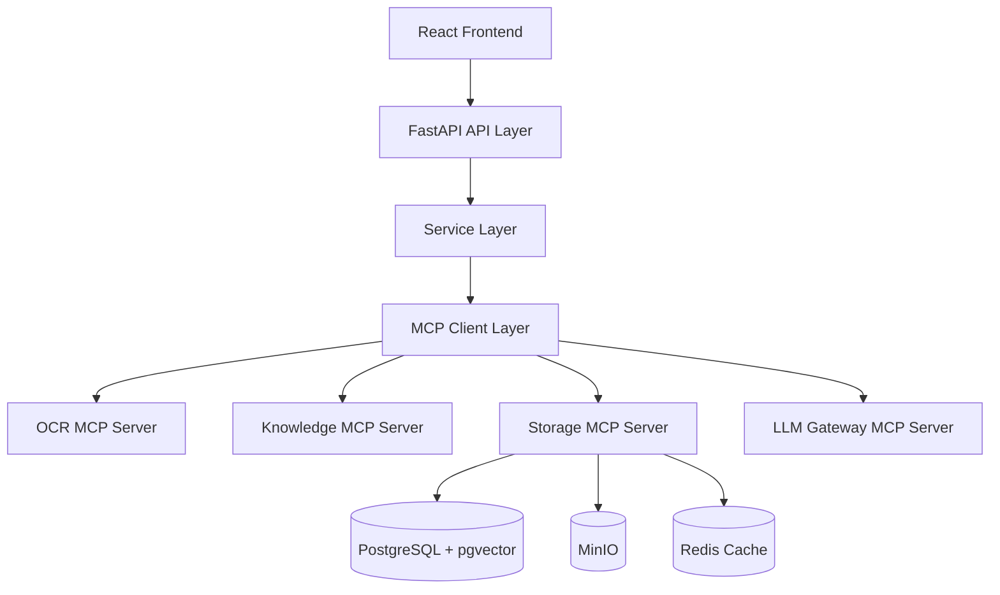

# AI Tutor Personal Edition

# System Architecture Design (SAD)

# Version 3.0 — Consolidated Edition

---

# CHANGE LOG

v1.0 → v2.0

* Removed legacy Agent→Service→Repository ambiguity
* Introduced MCP-first architecture as core execution principle
* Aligned with MIS V1.1 tool definitions
* Removed Qdrant references (fully replaced by pgvector)
* Introduced LLM Gateway as mandatory control plane
* Unified Agent model (TutorAgent + KnowledgeAgent only)
* Clarified separation between SAD (architecture) and TDD (implementation)

---

# 1. System Design Principles

## 1.1 Core Philosophy

This system is designed under the following immutable principles:

### P1 — MCP First Architecture

All system capabilities MUST be exposed via MCP tools.

No direct LLM / DB / OCR access is allowed from Agents or Services.

---

### P2 — Gateway Controlled Intelligence

All LLM interactions MUST pass through:

```text id="sad_p2_flow"
LLM Gateway → Provider Routing → DeepSeek / MIMO
```

---

### P3 — Data First Principle

* Data = system foundation
* Knowledge = structured mapping
* No ephemeral reasoning storage

---

### P4 — Strict Layer Isolation

Each layer has single responsibility:

* Agent: orchestration only
* MCP: capability execution
* Service: business logic
* Repository: data access

---

# 2. High-Level Architecture



---

# 3. Agent Architecture

## 3.1 Allowed Agents (STRICT LIMIT)

Only two agents exist in the system:

---

## 3.1.1 TutorAgent

### Responsibility

* Student interaction
* Question solving orchestration
* Hint generation
* Streaming explanations

### Flow

```text id="sad_tutor_flow"
User → TutorAgent → MCP → LLM Gateway → Response Stream
```

---

## 3.1.2 KnowledgeAgent

### Responsibility

* Knowledge mapping
* Difficulty analysis
* Similar question retrieval
* Learning path inference

### Flow

```text id="sad_knowledge_flow"
Question → KnowledgeAgent → Knowledge MCP → pgvector → Mapping
```

---

## 3.2 Forbidden Agents

* OCR Agent ❌
* Storage Agent ❌
* Solver Agent ❌

All replaced by MCP tools.

---

# 4. MCP Architecture Layer

## 4.1 MCP is the ONLY execution layer

Agents cannot execute logic directly.

They must call MCP tools.

---

## 4.2 MCP Servers

### OCR MCP

* extract_document
* split_questions
* detect_wrong_mark
* extract_formula

---

### Knowledge MCP

* classify_subject
* classify_knowledge_points
* evaluate_difficulty
* map_question_to_knowledge

---

### Storage MCP

* save_question
* save_solution
* save_wrong_question
* get_question
* search_questions
* get_wrong_questions

---

### Training MCP

* generate_training_set
* generate_wrong_question_training
* generate_mock_exam

---

### LLM Gateway MCP

* solve_question
* review_solution
* generate_explanation
* compare_solutions

---

## 4.3 MCP Execution Rule

```text id="sad_mcp_rule"
Agent → MCP Client → MCP Server → Service → Infra
```

---

# 5. LLM Gateway Architecture

## 5.1 Role

LLM Gateway is the ONLY access point to LLM providers.

---

## 5.2 Providers

* DeepSeek R1 (reasoning)
* MIMO V2.5 Pro (fast inference)

---

## 5.3 Routing Strategy

| Task Type   | Provider |
| ----------- | -------- |
| Fast Answer | MIMO     |
| Reasoning   | DeepSeek |
| Tutor Mode  | Hybrid   |

---

## 5.4 Responsibilities

* Prompt management
* Token tracking
* Cost control
* Fallback routing

---

# 6. Data Architecture

## 6.1 Storage Stack

* PostgreSQL (core relational data)
* pgvector (semantic search only)
* MinIO (file storage)
* Redis (cache/session)

---

## 6.2 Data Flow

```text id="sad_dataflow"
Document → MinIO → OCR MCP → Question Split → PostgreSQL → pgvector → Knowledge MCP
```

---

## 6.3 Strict Rule

> NO reasoning, prompt, or COT data is stored.

Only:

* Questions
* Answers
* Knowledge mappings
* Wrong records
* Metadata

---

# 7. System Workflow Architecture

## 7.1 Document Processing Flow

```text id="sad_flow_doc"
Upload
→ MinIO
→ OCR MCP
→ split_questions
→ Storage MCP
→ Knowledge MCP
```

---

## 7.2 Solution Flow

```text id="sad_flow_sol"
Question
→ TutorAgent
→ LLM Gateway
→ Solution generated
→ Storage MCP
→ DB
```

---

## 7.3 Wrong Question Flow

```text id="sad_flow_wrong"
Image
→ detect_wrong_mark
→ Question extraction
→ Storage MCP
→ Similarity search (pgvector)
```

---

# 8. Knowledge System Architecture

## 8.1 Knowledge Model

Predefined hierarchical tree:

* Mathematics
* Physics
* Chemistry
* English
* Chinese

Each contains:

* Topics
* Subtopics
* Leaf nodes

---

## 8.2 Rule

> Knowledge nodes are STATIC.

AI cannot generate new nodes.

---

## 8.3 Mapping Flow

```text id="sad_knowledge_map"
Question → Knowledge MCP → Vector Match → Node ID
```

---

# 9. API Layer Positioning (ACS Alignment)

SAD strictly defines:

* API Layer = thin orchestration only
* No business logic allowed
* No LLM calls allowed
* No DB access allowed

---

# 10. System Boundaries

## Allowed

* MCP calls
* Service orchestration
* Stateless computation

---

## Forbidden

* Direct DB access from Agents
* Direct LLM calls from API
* Cross-MCP internal calls
* Dynamic schema creation

---

# 11. Performance Architecture Targets

| Layer         | Latency Target |
| ------------- | -------------- |
| OCR MCP       | < 3s           |
| Knowledge MCP | < 800ms        |
| Storage MCP   | < 500ms        |
| LLM Gateway   | < 8s           |

---

# 12. Failure Handling Strategy

## 12.1 MCP Failure

* retry 2 times
* fallback provider if LLM failure

---

## 12.2 LLM Failure

* switch provider
* degrade to hint mode

---

## 12.3 OCR Failure

* fallback to Pix2Text + PaddleOCR

---

# 13. Observability Model

Each request MUST include:

* request_id
* trace_id
* latency
* tool usage
* cost estimate

---

# 14. Architecture Governance Rules

## Rule 1

SAD defines structure, not implementation.

---

## Rule 2

If conflict exists:

```text id="sad_rule2"
TASK.md > MIS.md > ACS.md > SAD.md
```

---

## Rule 3

SAD cannot override execution contracts.

---

## Rule 4

All new features must be MCP-first.

---

# 15. Architecture Freeze Statement

This architecture is considered stable.

Any modification must satisfy:

* MCP compatibility
* No new agent introduction
* No bypass of LLM Gateway
* No direct DB access changes

---

# SAD V2.0 — ARCHITECTURE LOCKED

---

# 16. Agent Architecture (from AAD v2.0)

## 16.1 Agent Topology

System contains only two agents:

### TutorAgent

Responsibilities:
* Student interaction
* Question solving orchestration
* Hint generation
* Streaming explanations
* Similar question recommendation

Non-Responsibilities:
* No direct database access
* No direct vector store access
* No direct MinIO access
* No direct LLM access

### KnowledgeAgent

Responsibilities:
* Subject classification
* Knowledge point classification
* Difficulty classification
* Similarity analysis

KnowledgeAgent is not user-facing. It operates during ingestion pipeline.

### Forbidden Agents

* OCR Agent ❌
* Storage Agent ❌
* Solver Agent ❌
* PlannerAgent ❌
* TeacherAgent ❌

All replaced by MCP tools.

## 16.2 Agent Runtime Flow

TutorAgent:
```text
User Request → TutorAgent → Tool Decision → MCP Tool → LLM Gateway → Response → User
```

KnowledgeAgent:
```text
Question → KnowledgeAgent → Knowledge Tools → Storage Tools → Response
```

## 16.3 TutorAgent Tool Set

Available tools:
* SearchQuestionTool
* GetQuestionTool
* GetSolutionTool
* GenerateHintTool
* GenerateSolutionTool
* FindSimilarQuestionTool
* GenerateTrainingSetTool

Limits: Max 5 tool calls per request, max 2 retries per tool.

## 16.4 KnowledgeAgent Tool Set

Available tools:
* ClassifySubjectTool
* ClassifyKnowledgeTool
* DifficultyTool
* SimilarityTool

## 16.5 Knowledge Classification Rules

Workflow:
```text
LLM Classification → Knowledge Mapper → Knowledge Tree → Matched Node → Save
```

If not matched: UNKNOWN node. Never INSERT new knowledge points.

## 16.6 Agent State Model

States: CREATED → RUNNING → WAITING_TOOL → WAITING_LLM → SUCCESS / FAILED

Stored only in runtime memory. Never persisted.

## 16.7 Agent Memory Strategy

Session memory only. No long-term memory. Destroyed after response.

## 16.8 Token Budget Control

* TutorAgent: Max 20k tokens context
* KnowledgeAgent: Max 8k tokens context
* Exceeding: Context compression

## 16.9 Cost Router

Routing:
* classification → MIMO
* difficulty → MIMO
* hint → MIMO
* solution → DeepSeek
* hard_solution → DeepSeek Reasoning

## 16.10 Retry Strategy

* Tool failure → Retry 2 times
* LLM failure → Switch provider (DeepSeek ↔ MIMO)
* Exceeded → Graceful failure (no infinite retry)

---

# 17. Execution Details (from TDD v1.2)

## 17.1 LLM Gateway Mode System

| Mode      | Behavior                           | Provider |
| --------- | ---------------------------------- | -------- |
| fast      | low latency response               | MIMO     |
| reasoning | DeepSeek R1 multi-step reasoning   | DeepSeek |
| tutor     | pedagogical structured explanation | Hybrid   |

Mode rules:
* ❌ Mode must NOT appear in MCP tools, database schema, or ACS response body
* ✔ Mode exists ONLY in Gateway runtime context

## 17.2 Solution Generation Pipeline

```text
Question → Service Layer → MCP (Storage/Knowledge) → LLM Gateway (mode selection) → Provider → Structured output
```

Output format:
```json
{
  "final_answer": "",
  "solution_steps": [],
  "explanation": ""
}
```

## 17.3 MCP vs Gateway Boundary

MCP responsibilities: data retrieval, OCR extraction, knowledge mapping, storage operations.

Gateway responsibilities: model selection, reasoning strategy, prompt assembly, fallback handling.

Hard boundary: MCP MUST NEVER decide model, decide mode, or interpret reasoning strategy.

## 17.4 Error Handling

* MCP error → Service catch → ACS error format
* Gateway error → Fallback provider

## 17.5 Execution Consistency Rules

Layer order (STRICT): ACS → Service → MCP → Gateway → Provider

Forbidden:
* ❌ API calling LLM directly
* ❌ MCP calling Gateway directly
* ❌ Service bypassing MCP

Same input → same MCP result (determinism rule).

---

# 18. Phase 2 Architecture Extension (Merged from SAD-Phase2 v3.0)

## 18.1 Student Frontend Architecture

Phase 2 introduces student-facing entry point:

```text
/           → Student Frontend (AskPage, WrongBookPage)
/admin      → Admin Backend (QuestionManage, Statistics)
```

Both entry points share the same backend services.

---

## 18.2 Dual-Task Parallel Architecture

Student ask flow triggers two parallel tasks:

```text
Student Submit Question
    │
    ├──→ Task A (Immediate): Vision LLM → Difficulty → Thinking Hint → Choice → Solution
    │
    └──→ Task B (Async): Image Enhance → OCR → Visual Extraction → Storage → Classification → Embedding
```

Task A is blocking (student waits for response).
Task B is non-blocking (async background processing).

---

## 18.3 Failure Recovery Architecture

```text
Vision LLM Success → Normal Flow
Vision LLM Failure → OCR Fallback → Text LLM
OCR Failure → Prompt Re-upload
All Failure → User-friendly Error + Log
```

---

## 18.4 LLM Gateway Vision Extension

LLM Gateway now supports multimodal models:

| Task Type | Model Type | Provider |
|-----------|------------|----------|
| Text Solution | Text Model | DeepSeek / MIMO |
| Image Solution | Vision Model | DeepSeek-VL / Qwen-VL |
| Thinking Hint | Text Model | DeepSeek |
| Visual Extraction | Vision Model | DeepSeek-VL / Qwen-VL |

Same API KEY can invoke different model types.

---

## 18.5 New MCP Tools (Phase 2)

### LLM Gateway MCP (Extended)

* generate_thinking_hint
* extract_visual_structure
* evaluate_difficulty_v2
* identify_subject

### Student MCP (New)

* ask_question
* get_hint
* get_solution
* choose_mode

---

## 18.6 Structured Visual Extraction

Vision model outputs structured JSON:

```json
{
  "question_text": "...",
  "diagram_elements": [],
  "relationships": [],
  "subject": "...",
  "knowledge_points": []
}
```

Supports: geometry, circuits, chemistry apparatus.
