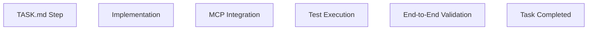

# AI Tutor Personal Edition

# Development Workflow (DEVELOPMENT WORKFLOW.md)

# Version 2.0 — Execution Governance Edition

---

# CHANGE LOG

v1.0 → v2.0

* Aligned execution phases with TASK.md V1.0 (source of truth)
* Removed outdated Phase model (no longer independent)
* Introduced MCP-first development enforcement
* Unified with Project Rules V2.0 architecture constraints
* Clarified TASK.md supremacy over all workflow definitions
* Added strict “no parallel task execution” rule
* Standardized MVP gating based on end-to-end pipeline validation

---

# 1. Core Execution Philosophy

## 1.1 TASK.md is the ONLY Execution Source

This document is NOT a task definition document.

It is a **workflow enforcement layer only**.

---

### Execution Priority

```text id="wf_priority"
TASK.md > MIS.md > ACS.md > SAD.md > WORKFLOW
```

---

## 1.2 MCP-First Development Principle

All features must follow:

```text id="wf_mcp"
Implementation → MCP Tool → MCP Server → Service → Infra
```

---

## 1.3 Incremental Delivery Only

No big-bang development is allowed.

Every feature must be:

* small
* testable
* independently deployable

---

# 2. Execution Model (NEW)

## 2.1 Unified Execution Flow

All development MUST follow this pattern:



---

## 2.2 No Workflow Override Rule

This document cannot override TASK.md.

It only enforces execution discipline.

---

# 3. Phase System (ALIGNED TO TASK.md V1.0)

## IMPORTANT

Phases here are NOT planning phases.

They are **execution grouping labels only**.

---

# PHASE 0 — INFRASTRUCTURE FOUNDATION

## Scope

Mapped directly to TASK.md T0 series

---

### Includes:

* FastAPI backend bootstrap
* React frontend bootstrap
* PostgreSQL + pgvector setup
* MinIO setup
* Redis setup
* MCP base framework
* LLM Gateway skeleton
* Logging & observability

---

### Output Criteria

System must:

* start successfully via docker-compose
* connect all infra services
* expose health check endpoints

---

### Phase Gate

✔ All services running
✔ MCP base callable
✔ LLM Gateway mock working

---

# PHASE 1 — DOCUMENT & QUESTION PIPELINE

## Scope

TASK.md T1 series

---

### Includes:

* Document upload
* OCR MCP integration
* Question splitting
* Question storage
* Subject classification
* Difficulty classification
* End-to-end pipeline test

---

### Critical Flow

```text id="wf_p1_flow"
Upload → MinIO → OCR MCP → Split → Store → Retrieve
```

---

### Phase Gate (MVP CHECKPOINT 1)

✔ PDF/Image upload works
✔ OCR MCP returns structured blocks
✔ Questions stored in PostgreSQL
✔ Retrieval API works

---

# PHASE 2 — SOLUTION ENGINE

## Scope

TASK.md T2 series

---

### Includes:

* LLM Gateway integration
* Solution generation
* Hint generation
* Solution storage
* Solution review

---

### Critical Flow

```text id="wf_p2_flow"
Question → LLM Gateway → Provider → Solution → Storage MCP
```

---

### Phase Gate

✔ DeepSeek + MIMO routing works
✔ Solution generation stable
✔ No COT stored in DB

---

# PHASE 3 — WRONG QUESTION SYSTEM

## Scope

TASK.md T3 series

---

### Includes:

* Wrong mark detection
* Wrong question storage
* Similar question retrieval
* Vector search (pgvector)

---

### Critical Flow

```text id="wf_p3_flow"
Image → Detection → Question → Embedding → pgvector → Similarity
```

---

### Phase Gate

✔ Wrong detection works
✔ Similarity search returns valid results

---

# PHASE 4 — KNOWLEDGE SYSTEM

## Scope

TASK.md T4 series

---

### Includes:

* Knowledge mapping
* Knowledge tree enforcement
* UNKNOWN handling
* Knowledge API

---

### Critical Flow

```text id="wf_p4_flow"
Question → Knowledge MCP → Vector Match → Node Mapping
```

---

### Phase Gate

✔ Knowledge tree is static and loaded
✔ Mapping produces valid node IDs
✔ UNKNOWN fallback works

---

# PHASE 5 — TUTOR SYSTEM

## Scope

TASK.md T5 series

---

### Includes:

* Tutor chat API (SSE streaming)
* Hint generation
* Similar question recommendation

---

### Critical Flow

```text id="wf_p5_flow"
User → TutorAgent → MCP → LLM Gateway → Stream Response
```

---

### Phase Gate

✔ SSE streaming works
✔ First token latency < 1.5s
✔ Tutor responds contextually

---

# PHASE 6 — SYSTEM HARDENING

## Scope

TASK.md T6 series

---

### Includes:

* Cost tracking system
* Token control enforcement
* Fallback system
* Error standardization

---

### Phase Gate

✔ Cost tracking accurate
✔ Provider fallback works
✔ Error format consistent

---

# PHASE 7 — FRONTEND INTEGRATION

## Scope

TASK.md T7 series

---

### Includes:

* Upload UI
* Question viewer
* Solution viewer
* Tutor chat UI
* Wrong question dashboard

---

### Phase Gate

✔ Full UI functional
✔ End-to-end user flow complete

---

# 4. MVP DEFINITION (UPDATED)

System is MVP complete when:

### Must-pass pipeline:

```text id="wf_mvp"
Upload → OCR → Split → Store → Solve → Display
```

---

### Required Capabilities:

* Document upload working
* Question extraction working
* Solution generation working
* Storage stable
* Retrieval stable
* Tutor streaming working

---

# 5. EXECUTION RULES

## 5.1 Single Task Execution

Only ONE task may be active at a time.

---

## 5.2 No Phase Skipping

Tasks MUST be executed in strict order:

```text id="wf_order"
T0 → T1 → T2 → T3 → T4 → T5 → T6 → T7
```

---

## 5.3 MCP Enforcement Rule

All features MUST use MCP layer.

No exceptions.

---

## 5.4 No Direct LLM Rule

All LLM calls MUST go through LLM Gateway.

---

## 5.5 No Direct DB Rule

All DB operations MUST go through Storage MCP.

---

## 5.6 Incremental Commit Rule

Each task MUST:

* compile successfully
* pass tests
* integrate MCP correctly

---

# 6. QUALITY GATES

Each task must pass:

* Unit tests
* MCP integration test
* API contract validation (ACS)
* Logging verification
* Error handling validation

---

# 7. ARCHITECTURE CONSISTENCY RULE

If conflict exists:

```text id="wf_consistency"
TASK.md overrides EVERYTHING
```

---

# 8. FINAL STATEMENT

This workflow document defines execution discipline only.

It does not define architecture, design, or implementation.

---

# DEVELOPMENT WORKFLOW V2.0 — EXECUTION LOCK

---

# 9. Test Strategy (from TEST_PLAN v1.0)

## 9.1 Testing Levels

Level 1: Unit Test (pytest)
Level 2: Integration Test (PostgreSQL, Redis, MinIO, LLM Gateway)
Level 3: System Test (end-to-end pipeline)
Level 4: User Acceptance Test

## 9.2 Coverage Requirements

| Layer      | Coverage |
| ---------- | -------- |
| Service    | ≥80%     |
| Repository | ≥90%     |
| Agent      | ≥70%     |
| API        | ≥80%     |

## 9.3 Key Test Scenarios

* OCR Pipeline: PDF/DOC/DOCX/JPG/JPEG/PNG/TIFF/BMP/GIF → Question extraction ≥95%
* Subject Classification: 100 questions → accuracy ≥95%
* Knowledge Mapping: 100 questions → accuracy ≥90%
* Solution Generation: 100 questions → success ≥95%
* Similar Question Search: Top 5 recall ≥80%

## 9.4 Performance Targets

* Concurrent requests: 10
* Average response: < 3 seconds
* P95: < 5 seconds

## 9.5 UAT Scenarios

1. Upload PDF → Generate questions → Store → Pass
2. Upload wrong question → Generate solution → Store → Pass
3. Search similar question → Retrieve result → Pass
4. Generate training set → Pass
5. Generate mock exam → Pass

## 9.6 MVP Acceptance Criteria

All operational: Upload → OCR → Split → Classify → Knowledge Map → Solve → Wrong Question Library

---
